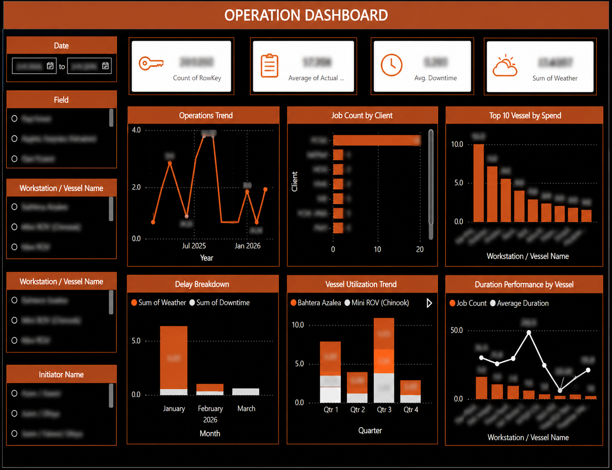

# Operations Analytics Dashboard

## Purpose

This dashboard was developed to monitor subsea operational activity, vessel utilization, campaign duration, delays, and client-job distribution.

## Key Measures

- Total job count
- Average operation duration
- Average downtime
- Weather-related delay
- Job count by client
- Vessel utilization
- Duration performance by vessel

## Analytical Features

- Date filtering
- Field filtering
- Vessel and workstation filtering
- Initiator filtering
- Monthly operational trend
- Client-job distribution
- Delay breakdown
- Quarterly vessel-utilization analysis
- Vessel-duration comparison

## Dashboard Preview

## Data Protection

Client names, field names, vessel details, employee names, operational figures, and project information have been anonymized or blurred.