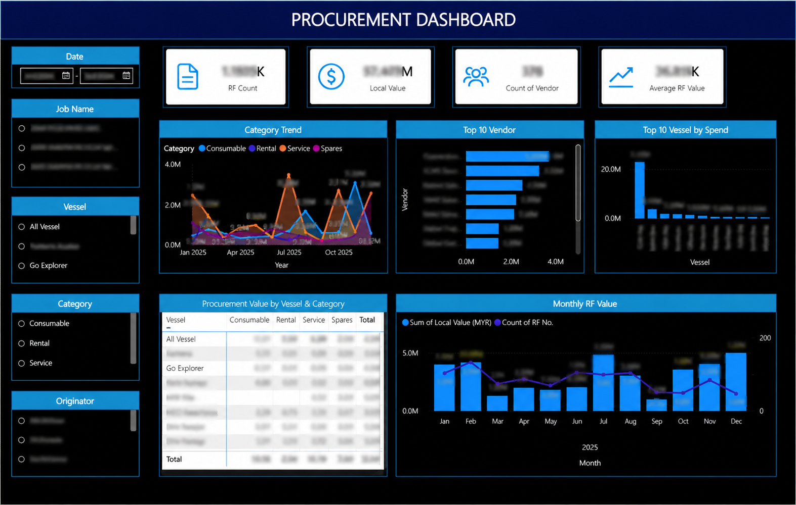

# Procurement Analytics Dashboard

## Purpose

This dashboard was developed to provide management with a consolidated view of procurement activities and expenditure.

## Key Measures

- Total RF count
- Total procurement value
- Number of vendors
- Average RF value
- Monthly procurement value
- Spending by procurement category
- Top vendors by value
- Top vessels by expenditure

## Analytical Features

- Date filtering
- Job and campaign filtering
- Vessel filtering
- Procurement-category filtering
- Originator filtering
- Monthly trend analysis
- Vendor-ranking analysis
- Vessel and category comparison

## Dashboard Preview

## Data Protection

Supplier names, project references, vessel information, employee names, and financial figures have been anonymized or blurred.